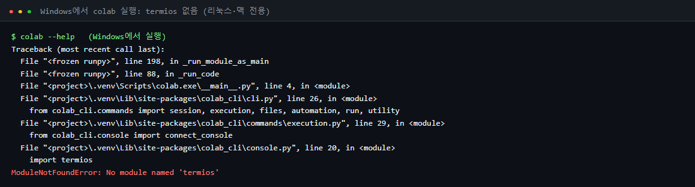

# 🛠️ Vision AI 특강 정리: 환경 설정과 CLI 연결

> **내 PC는 명령만 내리고, 무거운 연산은 Colab GPU가 한다.**
> 이 특강의 핵심은 모델이 아니라, 그 연결을 가능하게 하는 **환경 설정**과 **CLI 연결**입니다.

실습 원본: [yblee110/vision-ai-notebook](https://github.com/yblee110/vision-ai-notebook)


## 📁 들어 있는 것

| 파일 | 내용 |
|---|---|
| [`Vision_AI_특강_정리.ipynb`](Vision_AI_특강_정리.ipynb) | 정리 노트북 (설명 + 환경 확인 코드 + 캡처) |
| [`Vision_AI_특강_정리.pdf`](Vision_AI_특강_정리.pdf) | 같은 내용의 PDF (A4) |
| [`특강_정리본.md`](특강_정리본.md) | 같은 내용의 마크다운 정리본 |
| `images/` | 직접 실행하며 캡처한 화면과 구조도 |
| [`code/run_cpu_demo.py`](code/run_cpu_demo.py) | 부록용: 실습 모델 코드를 CPU로 재현한 스크립트 |
| [`tools/content.md`](tools/content.md) | 원고. `python tools/build_all.py`로 노트북·md·PDF를 다시 만든다 |

## 🗂 목차

0. 내 소감: README가 안 보여서 막혔던 점, CLI를 쓰는 이유
1. 한눈에 보기: 환경 3층 구조
2. 왜 환경을 이렇게 나누나 (내 PC, Codespaces, Colab GPU)
3. 1층: Codespaces 자동 세팅 (`devcontainer.json`, `Dockerfile`, `setup.sh`, `doctor.py`)
4. 직접 해보니: Windows에서 재현한 결과
5. 2층: 인증 (Hugging Face, Google OAuth2)
6. 3층: Colab 런타임 연결 (`new`, `upload`, `exec`, `restart-kernel`, `download`, `stop`)
7. 연결 자동화: 셸 스크립트와 에이전트 스킬
8. GPU 고르기와 비용
9. 환경 트러블슈팅
10. 복습 체크리스트
- 부록: 실습 코드 흐름, 모델 실행 결과

## 🔍 직접 해보고 알게 된 것

| 시도 | 결과 | 배운 점 |
|---|---|---|
| Python 3.10에 Colab CLI 설치 | 실패 | Colab CLI는 Python 3.12 이상 필요 |
| `uv`로 Python 3.12 환경 생성 | 성공, 수업 패키지 11개 설치 | `setup.sh`가 하는 일을 그대로 재현 |
| `doctor.py` 점검 | 패키지·`hf`는 OK, `colab`은 오류 | 점검 스크립트로 환경 문제를 바로 찾는다 |
| Windows에서 `colab --help` | `termios` 없음 오류 | Colab CLI는 리눅스·맥 전용 → **Codespaces를 쓰는 이유** |
| `run_pipeline_colab.sh --dry-run` | 9단계 연결 계획 출력 | 로그인·GPU 없이 연결 흐름을 미리 확인 |



## ⚡ 핵심 명령 요약

```bash
# 1층: 환경 점검 (Codespaces 터미널)
source .venv/bin/activate
python scripts/doctor.py

# 2층: Google 로그인
colab --auth oauth2 sessions

# 3층: Colab GPU 연결
colab new -s hf-vision-gpu --gpu T4
colab upload -s hf-vision-gpu hf_colab_gpu/requirements-torch.txt content/requirements-torch.txt
colab exec -s hf-vision-gpu --timeout 1800 <<'PY'
import subprocess, sys
subprocess.run([sys.executable,'-m','pip','install','-r','/content/requirements-torch.txt'], check=True)
PY
colab restart-kernel -s hf-vision-gpu
colab exec -s hf-vision-gpu -f hf_colab_gpu/notebooks/01_gpu_inference.ipynb --timeout 1800
colab stop -s hf-vision-gpu
colab sessions
```

## 📚 출처
- 실습 코드와 환경 설정: [yblee110/vision-ai-notebook](https://github.com/yblee110/vision-ai-notebook)
- Colab CLI: [googlecolab/google-colab-cli](https://github.com/googlecolab/google-colab-cli)
- 모델: [facebook/deit-tiny-patch16-224](https://huggingface.co/facebook/deit-tiny-patch16-224)
- 데이터: [CIFAR-100](https://www.cs.toronto.edu/~kriz/cifar.html)
