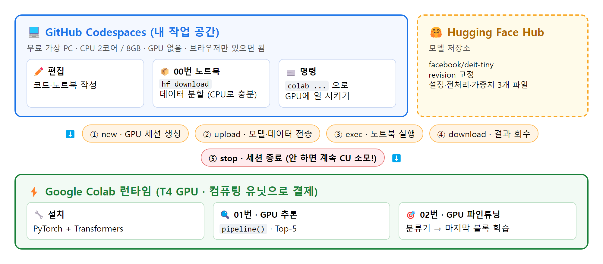
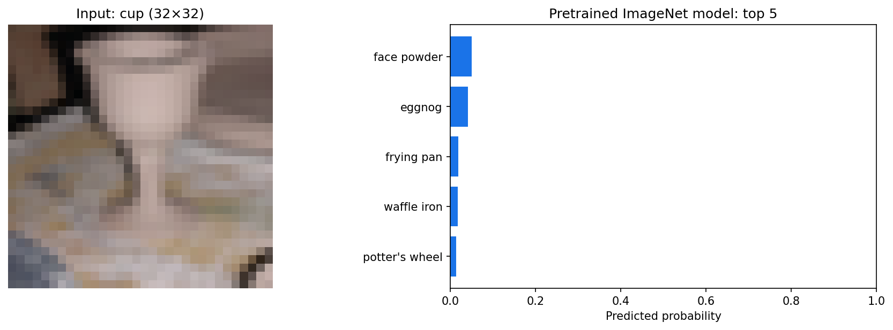
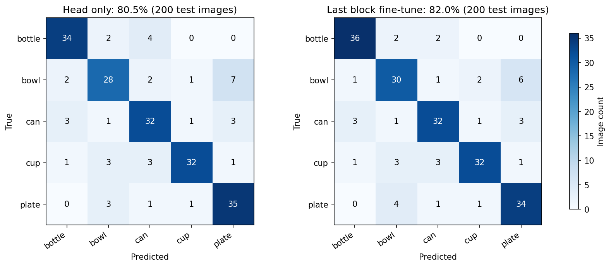

# 🧠 Vision AI 특강 정리 · Hugging Face CLI + Colab CLI

> **내 컴퓨터는 명령만 내리고, 무거운 연산은 Colab GPU가 한다.**
> 사전학습 모델(DeiT-tiny)을 받아 추론하고, 병·그릇·캔·컵·접시 5개 클래스로 가볍게 파인튜닝하는 특강을 정리한 저장소입니다.

실습 원본: [yblee110/vision-ai-notebook](https://github.com/yblee110/vision-ai-notebook)



## 📁 들어 있는 것

| 파일 | 내용 |
|---|---|
| [`Vision_AI_특강_정리.ipynb`](Vision_AI_특강_정리.ipynb) | 정리 노트북 (마크다운 설명 + 개념 코드 + 실행 결과 이미지) |
| [`Vision_AI_특강_정리.pdf`](Vision_AI_특강_정리.pdf) | 같은 내용의 PDF (A4) |
| [`특강_정리본.md`](특강_정리본.md) | 같은 내용의 마크다운 정리본 |
| [`code/run_cpu_demo.py`](code/run_cpu_demo.py) | 00·01·02 핵심 단계를 **CPU로 재현**하는 스크립트 |
| [`code/cpu_run_log.txt`](code/cpu_run_log.txt) | 재현 실행 로그 |
| `images/` | 실행하면서 캡처한 그림 |
| `tools/` | 노트북·PDF를 다시 만드는 스크립트 |

## 🗂 정리 목차
0. 내 소감: 마크다운이 안 보여 힘들었던 점, CLI를 쓰는 이유
1. 전체 그림
2. Colab CLI란? (Colab 노트북과 비교)
3. 왜 Colab CLI인가? (컴퓨팅 유닛, 비용 안전성, RunPod·GCP 비교)
4. Colab CLI 핵심 명령어와 주의점
5. Hugging Face CLI와 revision 고정
6. 개발 환경: Fork → Codespaces
7. 실습 흐름: 00 · 01 · 02 노트북
8. 핵심 코드 4개 + `pipeline()` + **코드 쉽게 읽기**
9. 파인튜닝 개념과 결과 + **직접 실행해 본 결과**
10. 셸 시연과 에이전트 스킬
11. GPU 고르는 법
12. 트러블슈팅
13. 마무리 메시지와 복습 체크리스트

## 🖥️ 직접 실행해 본 결과 (CPU 재현)

| 비교 | 내 CPU 재현 (2026-10-03) | 원본 저장소 T4 기록 (2026-09-19) |
|---|---:|---:|
| 분류기만 학습 (head) | **80.5%** | 80.0% |
| 마지막 블록까지 파인튜닝 | **82.0%** | 81.0% |
| 파인튜닝 최고 epoch | 2 | 2 |

| 원본 모델 추론 | 파인튜닝 결과 |
|---|---|
|  |  |

## ▶️ CPU 재현 다시 돌리기

```bash
python -m venv venv
venv/Scripts/pip install torch --index-url https://download.pytorch.org/whl/cpu
venv/Scripts/pip install "transformers==4.57.6" "huggingface_hub[cli]==0.36.0" numpy pillow matplotlib pyarrow
venv/Scripts/python code/run_cpu_demo.py
```

macOS·Linux에서는 `venv/Scripts/` 대신 `venv/bin/`을 씁니다. 모델 약 23MB와 데이터 약 142MB를 내려받고, CPU로 2분 정도 걸립니다.

## 📚 출처
- 실습 코드·구성: [yblee110/vision-ai-notebook](https://github.com/yblee110/vision-ai-notebook)
- 모델: [facebook/deit-tiny-patch16-224](https://huggingface.co/facebook/deit-tiny-patch16-224) (revision `b3428f18`)
- 데이터: [CIFAR-100](https://www.cs.toronto.edu/~kriz/cifar.html) ([uoft-cs/cifar100](https://huggingface.co/datasets/uoft-cs/cifar100))
